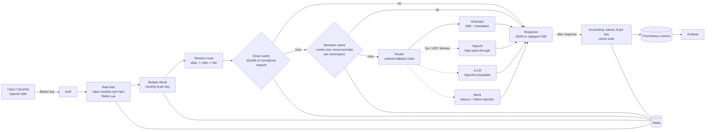

# LLM Gateway

One OpenAI-compatible endpoint in front of Anthropic, OpenAI, a self-hosted vLLM model, and an
in-process mock. Apps call the gateway instead of each provider. The gateway picks a model,
caches answers, falls back when a provider fails, enforces per-key rate limits and budgets, and
counts tokens and dollars per key.

- `POST /v1/chat/completions`: OpenAI format, streaming and tool calling included
- `POST /v1/embeddings`, `GET /v1/models` (lists aliases), `GET /healthz`, `GET /metrics`
- Admin (admin keys only): `GET /admin/usage`, `GET /admin/backends`, `POST /admin/backends/{name}`
  (failure injection for mock backends)

**Why.** Every app that talks to LLMs ends up rebuilding retries, provider switching, caching and
cost tracking. Doing it once, at the network edge, gives one place to measure it, in particular the
serving-side numbers that matter: TTFT, p99, cache hit rate, and $/request.

## Architecture



The request path is one readable function, `gateway/pipeline.py:chat_completions`:

1. **Auth**: Bearer key, looked up by `sha256(secret)` (`gateway/auth.py`).
2. **Rate limit**: two token buckets per key (requests/min, tokens/min), checked and debited
   atomically in one Lua script. Output tokens are unknown up front, so they are debited *after*
   the response and may push the bucket negative ("post-paid"). Returns `429` + `Retry-After`.
3. **Budget**: monthly spend per key in Redis. When exhausted the gateway returns `402
   insufficient_quota`, not 429, because OpenAI SDKs auto-retry 429s.
4. **Route**: alias → first matching rule (e.g. long prompts → `local`) → tier check (disallowed
   aliases are downgraded to the tier default). Reported in `x-gateway-route`.
5. **Exact cache**, then **semantic cache** (see design decisions).
6. **Router**: tries the chain in order, falling back on 5xx / 429 / timeout / connection error;
   a 4xx is returned as-is. Backends without credentials are skipped silently.
7. **After the response is flushed** (a Starlette background task): bill the key, debit output
   tokens, write the caches, record metrics.

Response headers: `x-gateway-backend`, `x-gateway-model`, `x-gateway-alias`, `x-gateway-route`,
`x-gateway-cache: miss|exact|semantic`, `x-gateway-cost-usd` (omitted on streaming misses; the cost
isn't known until the last chunk), `x-gateway-overhead-ms`, `x-gateway-semantic-ms`,
`x-gateway-fallbacks`.

## Quickstart

### Docker (zero keys needed)

```bash
cp .env.example .env          # optional: add ANTHROPIC_API_KEY / OPENAI_API_KEY
docker compose up --build
# gateway  http://localhost:8080   (demo key: sk-gw-demo)
# grafana  http://localhost:3000   (dashboard "LLM Gateway", anonymous viewer)
# prom     http://localhost:9090
```

With no keys, every alias falls through to `mock-primary`, so the whole pipeline works (caching,
limits, metrics, fallback). Add keys to `.env` and restart to get real models. For the self-hosted
model on a GPU box: set `VLLM_ENABLED=true` and run `docker compose --profile gpu up`.

### Without Docker (no Redis needed)

```bash
python -m venv .venv && . .venv/Scripts/activate      # Windows Git Bash; use .venv/bin/activate on Linux/macOS
pip install -e ".[dev,local]"
GATEWAY_REDIS_URL=fakeredis:// uvicorn gateway.main:app --port 8080 --env-file .env
pytest -q
```

`fakeredis://` runs an in-process Redis with Lua support. State is lost on restart, and it's
single-process only.

### curl

```bash
# non-streaming (temperature 0 -> cacheable; run it twice and watch x-gateway-cache)
curl -si localhost:8080/v1/chat/completions -H "Authorization: Bearer sk-gw-demo" \
  -H "Content-Type: application/json" \
  -d '{"model":"fast","temperature":0,"messages":[{"role":"user","content":"What is a KV cache?"}]}'

# streaming, with usage in the final chunk
curl -N localhost:8080/v1/chat/completions -H "Authorization: Bearer sk-gw-demo" \
  -H "Content-Type: application/json" \
  -d '{"model":"fast","stream":true,"stream_options":{"include_usage":true},
       "messages":[{"role":"user","content":"Explain continuous batching"}]}'

# tool calling
curl -s localhost:8080/v1/chat/completions -H "Authorization: Bearer sk-gw-demo" \
  -H "Content-Type: application/json" \
  -d '{"model":"smart","messages":[{"role":"user","content":"Find docs about rate limits"}],
       "tools":[{"type":"function","function":{"name":"search_docs","description":"Search the docs",
         "parameters":{"type":"object","properties":{"query":{"type":"string"}},"required":["query"]}}}]}'

# embeddings, per-key usage, cut a provider
curl -s localhost:8080/v1/embeddings -H "Authorization: Bearer sk-gw-demo" \
  -H "Content-Type: application/json" -d '{"model":"embed","input":["hello"]}'
curl -s localhost:8080/admin/usage -H "Authorization: Bearer sk-gw-demo"
curl -s -XPOST localhost:8080/admin/backends/mock-primary -H "Authorization: Bearer sk-gw-demo" \
  -H "Content-Type: application/json" -d '{"down":true}'
```

### OpenAI Python SDK

```python
from openai import OpenAI

client = OpenAI(base_url="http://localhost:8080/v1", api_key="sk-gw-demo")
resp = client.chat.completions.with_raw_response.create(
    model="fast", temperature=0, messages=[{"role": "user", "content": "Hello"}])
print(resp.headers["x-gateway-backend"], resp.headers["x-gateway-cache"])
print(resp.parse().choices[0].message.content)

for chunk in client.chat.completions.create(model="smart", stream=True,
                                            messages=[{"role": "user", "content": "Stream please"}]):
    if chunk.choices and chunk.choices[0].delta.content:
        print(chunk.choices[0].delta.content, end="")
```

### Pointing DocPilot at the gateway

DocPilot uses the OpenAI SDK, so it needs only a base URL, a key and model names:

```bash
OPENAI_BASE_URL=http://localhost:8080/v1
OPENAI_API_KEY=sk-gw-docpilot-change-me   # the value of GATEWAY_KEY_DOCPILOT in the gateway's .env
# chat model: an alias such as `smart` or `fast`; embeddings: `embed` or `text-embedding-3-small`
```

Tool calling and embeddings both go through. An alias can carry a real model's name (see
`text-embedding-3-small` in the config), so a client hard-coded to that name works unchanged.

## Configuration (`config/gateway.yaml`)

`${VAR}` / `${VAR:-default}` are substituted from the environment. References are validated at
startup: an unknown backend, alias or tier stops the process.

| Section | What it is |
|---|---|
| `backends[]` | `name`, `type` (`anthropic` \| `openai` \| `vllm` \| `mock`), `base_url`, `api_key_env`, `timeout_s` (whole request, or time-to-first-chunk when streaming), `enabled`, `mock:` {`ttft_ms`, `tokens_per_s`, `output_tokens`, `error_rate`, `down`} |
| `aliases` | `name: [{backend, model}, ...]`: the ordered fallback chain clients address as `model` |
| `default_alias` | used when a request has no `model` |
| `rules[]` | `{name, min_prompt_tokens, aliases?, route_to}`; first match rewrites the alias (only for the listed source aliases) |
| `tiers` | `{allowed_aliases, default_alias}`; a key's tier limits which chains it may use |
| `prices` | USD per 1M tokens `{input, output}` per backend model; unknown models cost 0 |
| `api_keys[]` | `id`, `secret_sha256` or `secret_env`, `tier`, `rpm`, `tpm`, `monthly_budget_usd`, `admin` |
| `cache` | `exact {enabled, ttl_s}`, `semantic {enabled, threshold, max_entries, ttl_s, embedding_alias}`, `require_zero_temperature` |

Per request, the header `x-gateway-cache: allow` caches even at temperature > 0, and
`x-gateway-cache: skip` bypasses both caches.

Process settings come from the environment: `GATEWAY_CONFIG` (path), `GATEWAY_REDIS_URL`
(`redis://...` or `fakeredis://`), `GATEWAY_LOG_LEVEL`.

## Load test

```bash
pip install -e ".[loadtest]"
python loadtest/prompt_trace.py synthetic --n 3000 --out loadtest/data/trace.jsonl
#   or real prompts: python loadtest/prompt_trace.py sharegpt --path ShareGPT_V3_unfiltered_cleaned_split.json --n 3000
docker compose restart redis gateway      # start from empty caches and counters
python loadtest/run_steps.py --host http://127.0.0.1:8080 --rates 5 10 20 40 --step-seconds 60 \
    --kill-backend mock-primary --kill-at-rate 20 --kill-after 20 --kill-for 20
python loadtest/report.py --results loadtest/results/<timestamp>
```

- The synthetic trace mixes three short system prompts, one long shared "documentation" system
  prompt (it trips the long-prompt rule), 15% exact duplicates and 10% near-duplicates.
  Each line records its `kind`, so cache hit rates can be checked against ground truth.
- `locustfile.py` streams every request and measures TTFT client-side (first content delta). It
  also emits custom Locust rows (`TTFT <backend>|<cache>`, `OVERHEAD_US <cache>`), so Locust's own
  CSV percentiles become the report tables.
- `run_steps.py` runs one Locust step per rate (`-u R` users × 1 req/s each), scrapes `/metrics`
  after each step, and can cut a mock backend mid-step via the admin endpoint. `report.py` diffs the
  scrapes per step and writes `loadtest/REPORT.md`.
- Use `127.0.0.1`, not `localhost`: on Windows, `localhost` tries IPv6 first, and each new connection
  can stall for about 2 s, which shows up as a fake p99.
- **Prefix-caching experiment** (vLLM): `python loadtest/prefix_cache_experiment.py --base-url
  http://localhost:8000/v1 --model Qwen/Qwen2.5-1.5B-Instruct`. It compares TTFT for a shared long
  system prompt (warm) against a unique-per-request prefix (no reuse possible), sequentially to
  avoid queueing effects. Pass its output to `report.py --prefix`.
- **Semantic threshold**: `python scripts/tune_semantic_threshold.py --pairs
  scripts/data/semantic_pairs_sample.jsonl` reports precision, recall and false-hit rate for each
  threshold. The bundled 40 pairs are a hand-written starter set full of hard negatives (France vs
  Germany, sort by key vs value). Extend it with labeled pairs from real traffic.

## Results

Measured numbers live in [`loadtest/REPORT.md`](loadtest/REPORT.md). That file is generated, never
hand-written. Until a run is done:

| Metric | Value |
|---|---|
| Gateway overhead per request, p50 / p99 | TO FILL |
| TTFT p50 / p99 per backend | TO FILL |
| Cache hit rate, $ saved | TO FILL |
| Fallback success rate with a provider cut mid-test | TO FILL |
| vLLM prefix caching: TTFT speedup on repeated long system prompts | TO FILL |

## Design decisions and trade-offs

- **One internal format.** Every backend takes and returns OpenAI-shaped dicts, so caching,
  billing and streaming code understands one schema. Only the Anthropic adapter translates.
- **Anthropic translation** (`gateway/backends/anthropic_translate.py`, pure functions):
  - system/developer messages → top-level `system`
  - `assistant.tool_calls` → `tool_use` blocks
  - consecutive `role: tool` messages → one user message of `tool_result` blocks
  - OpenAI function tools → `input_schema`
  - `stop_reason` mapping: `end_turn`/`stop_sequence` → `stop`, `tool_use` → `tool_calls`,
    `max_tokens` → `length`, `refusal` → `content_filter`
  - usage: prompt tokens = input + cache-read + cache-write tokens
  - streaming: Anthropic block events become flat `chat.completion.chunk`s; block indices are
    remapped to tool-call indices, and thinking deltas are dropped.

  Deliberate gaps:
  - **`tool_choice`: only `auto`/`none` are mapped.** `required` or a named function would become
    Anthropic `any`/`tool`, which current Claude models (Opus/Sonnet 5.5) reject with a 400. They
    degrade to `auto` with a warning in the log. Callers who need a guaranteed call should say so
    in the prompt and check the response.
  - `temperature`/`top_p` are dropped for `claude-*-5*` models (they 400 there).
  - `thinking` is never sent.
  - A trailing assistant message (prefill) returns a clear 400.
  - `n > 1` is unsupported, and so are embeddings on Anthropic.
  - SDK retries are off (`max_retries=0`): the router owns retries, and stacked SDK retries
    would silently multiply tail latency before fallback ever happens.
- **Fallback only before the first byte when streaming.** Once a client has received part of an
  answer, switching backends would splice two different generations into one response. So the
  router waits for the first chunk (bounded by `timeout_s`) before committing. A failure after that
  becomes an SSE `error` event. The cost is that a backend dying mid-stream is not retried.
- **Retryable vs not.** 5xx, 429, timeouts and connection errors fall back. Other 4xx do not:
  another provider won't fix a malformed request, and falling back would hide the bug while adding
  latency.
- **Exact-cache key normalization.** The key is a sha256 over the resolved alias, the messages
  (role/content/tool_calls/tool_call_id/name, with string content trimmed) and the fields that
  change the answer (tools, tool_choice, sampling params, max_tokens, stop, response_format,
  seed…). JSON keys are sorted. `stream`, `stream_options`, `user` and `metadata` are excluded,
  so a streamed and a non-streamed request share one entry, and stream hits are replayed as SSE.
  Only deterministic requests are cached (temperature 0) unless the client opts in; otherwise the
  cache would freeze one random sample forever. Requests with tools *are* exact-cached, since
  identical tools plus history means identical input.
- **Semantic cache with numpy cosine.**
  - **Embedding:** only the last user message is embedded.
  - **Namespace:** everything else that shapes the answer (alias, system prompt, earlier turns,
    answer params) is hashed into a namespace, so different system prompts or histories can
    never collide.
  - **Search:** each namespace keeps the N most recent vectors in Redis, and lookup is a
    brute-force matrix-vector product in numpy. At N=2000 that's sub-millisecond, and the code is
    obviously correct. HNSW in Redis Stack, or pgvector, is the path when the namespace grows to
    millions of entries.
  - **Tools:** semantic caching is skipped for tool requests, because "same question" doesn't imply
    "same tool calls needed".
  - **Threshold:** strict by default (0.95), and every hit is logged as a JSON line with the
    similarity and both prompt hashes, so false hits can be audited.
  - **Cost:** a miss costs one embedding call, reported separately (`x-gateway-semantic-ms`). It is
    worth it only when hit rate × saved latency beats that cost.
  - **Mock embedder:** the hashing embedder is lexical, *not* semantic. Run the tuner with it to
    see why a real model and a labeled set are required.
- **Overhead definition.** `x-gateway-overhead-ms` is wall time minus time waiting on model calls
  (backends, including failed attempts, plus the semantic-cache embedding call), measured when
  response headers are built. For streams, that means overhead before the first byte. Per-chunk
  relay cost isn't included.
- **Accounting off the hot path.** The cost header is computed inline (a pure function). Redis
  writes for billing and caches run after the response is sent. Budgets are therefore a soft
  limit: concurrent requests can overshoot by about one request each. Reserving estimated cost up
  front would make the limit hard, at the price of a second Redis round trip.
- **Token counts.** Billing uses the backend's reported usage (streaming requests ask upstream for
  `include_usage`; the usage chunk is hidden again if the client didn't ask). Routing rules and
  rate limits use a ~4 chars/token estimate, because a tokenizer per provider isn't worth it for a
  threshold. Anthropic cache-read tokens are billed at the full input price (a slight
  overestimate).
- **One worker per container.** All shared state is in Redis, so scale out with replicas.
  In-process state (the Prometheus registry and the mock "down" toggle) stays unambiguous.

## Repo map

```
gateway/
  app.py               FastAPI routes, wiring, admin endpoints
  pipeline.py          the per-request pipeline (start here)
  router.py            alias/rule/tier resolution + fallback, stream first-byte logic
  limits.py            Lua token buckets (rpm+tpm), monthly budgets
  accounting.py        cost formula, per-key usage in Redis + Prometheus
  cache/exact.py       normalized request fingerprint, cacheability policy
  cache/semantic.py    namespaced embedding cache, numpy cosine
  backends/            base interface; openai_compat (OpenAI+vLLM); anthropic + anthropic_translate; mock
  openai_format.py     chunk/completion builders, SSE, stream accumulator, token estimate
  metrics.py, auth.py, config.py, errors.py, redis_client.py, main.py
config/gateway.yaml    backends, aliases, rules, tiers, prices, keys, caches
deploy/                prometheus.yml, grafana provisioning + dashboard, vllm-slurm.sh
loadtest/              prompt_trace.py, locustfile.py, run_steps.py, report.py,
                       prefix_cache_experiment.py, REPORT.md (generated)
scripts/               tune_semantic_threshold.py, data/semantic_pairs_sample.jsonl
tests/                 translation, backend, router, cache, limits, end-to-end (no network, no Docker)
```

### vLLM on a university cluster

`sbatch deploy/vllm-slurm.sh` starts `vllm serve` with prefix caching on a single GPU (set
`PREFIX_CACHING=0` for the off arm). Then tunnel the port with `ssh -N -L 8000:<node>:8000 <login>`
and set `VLLM_ENABLED=true` and `VLLM_BASE_URL=http://host.docker.internal:8000/v1` in `.env`.
